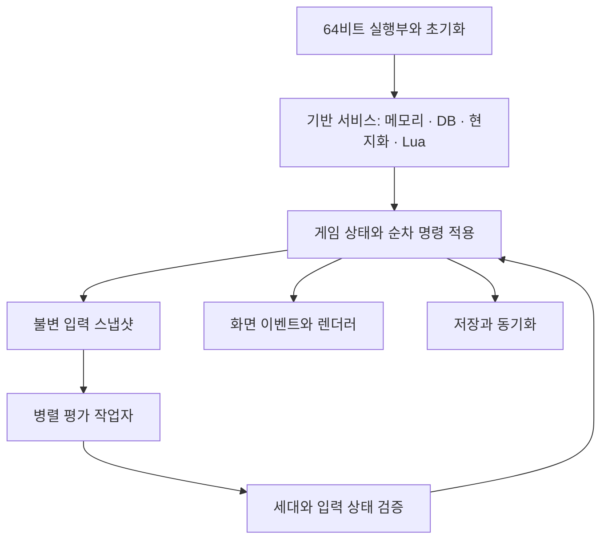

# 문명 5 네이티브 x64·멀티코어 초기 설계

2026-10-03 전체 완료 조건과 플레이를 막는 항목을 [현재 상태 대조표](ENGINE_COMPLETION_STATUS.md)에 모았사와요. 아래 부품별 통과 기록과 전체 게임 완료를 구분하며, 확인용 실행 모드에서 연속 사용자 게임 실행 경로로 통합하는 일을 우선하와요. 목표 범위는 기존 F01–F07/N01–N04를 유지한답니다.

2026-10-03에는 원본 `TechPopup`의 일반 연구 선택도 영어·한국어에서 실제 owned HWND 자동 클릭→원본 `(tech,0,-1,false)` 콜백 한 건→정상 1턴→새 세션 native 저장 복원까지 통과했사와요. 같은 창·장치의 초기·크기 변경·닫힘 GPU 캡처는 언어당 세 장이며 닫힌 context의 옛 좌표·Escape는 거부됐답니다. `SmallUIAssets` 저장값 1을 동결하고 실제 native 값과 대조했지만 AutoUIAssets의 retail 유효값은 미검증이와요. 전체 연구 UI·무료 기술·도둑질·예약·연구 트리·Civilopedia·사람 입력·retail 픽셀/저장 동등성은 남아 있답니다. [연구 UI 경계](M6_RESEARCH_UI.md) · [연구 EN/KO 대조표](../evidence/city_research_ui/validators/20261003T063605Z_6bec92a0bef8/conformance.json) · [중간 object 6개 정리](../evidence/build_tidy/20261003T062904Z_1cf6cdc63278/cleanup.json)

2026-10-03 생산 창의 실제 SDK 검증은 영어·한국어에서 유닛·건물 분류 접기와 펼치기, 마우스 강조와 해제, 빈 ScrollPanel 영역의 휠 전달과 최대값 0의 clamp, 이전 장면의 unit click·late Escape 거부로 확장됐사와요. Host `20261003T060726Z_eddea2a1f84d`의 같은 창·D3D 장치에서 장면 세대 1→8과 두 언어 GPU 캡처 총 18장을 대조했고, 원본 callback의 합법 유닛 주문·정상 1턴·새 세션 native 저장 복원도 통과했답니다.

관리된 자동 입력 두 fixture의 범위랍니다. 목록이 짧아 실제 스크롤 이동은 검증하지 않았고, 자동 OS mouse leave와 사람 입력·전체 생산·연구 UI·성공 구매·세계 화면·실제 음향·전체 gameplay·retail 저장·활성 모드 호환·유용한 성능 향상·장기 회귀·정식 배포는 남아 있사와요. 모든 Present는 시험 desktop의 `DXGI_STATUS_OCCLUDED`였답니다. [생산 UI의 구현과 범위](M6_CITY_DECISION_UI.md) · [현재 EN/KO 대조표](../evidence/city_production_ui/validators/20261003T064411Z_b1c560071648/conformance.json) · [이전 생산 빌드 정리](../evidence/build_tidy/20261003T052750Z_640de3a92369/cleanup.json)

2026-10-01 격리 실행부 후보는 영어·한국어 × worker 0·4의 네 실행에서 새 게임, 턴 1 native checkpoint의 fresh-session 복원과 50턴까지 정상 SDK 진행을 통과했사와요. 같은 언어의 세 archive는 독립 새 게임의 지도 GUID 16바이트만 정규화한 뒤 133개 구획 전체가 같고, 계속 진행한 모든 턴의 의미 상태 표본·명령·턴 이벤트도 일치했답니다. 29·38턴 합법 승급 입력과 25·50턴 공식 BNW 순위 팝업의 원문 Lua·실제 난수·타이머·retained control tree도 검증했사와요. 별도 M6 고정 turn-zero 입력은 영어·한국어에서 실제 SDK `MISSION_FOUND` 액션으로 도시를 건설하고, 새 GameCore 세션 native 복원 및 세 idle update를 확인했사와요. 이 역사적 건설 증거는 50턴 승급·팝업 시험과 별개이며 화면 입력이나 턴 진행을 포함하지 않는답니다. 2026-10-02에는 별도 영어·한국어 실행에서 SDK 도시 생산·연구 선택, 정상 1턴 진행, turn-zero와 turn-one native checkpoint의 fresh-session 복원을 검증했사와요. 각 언어의 각 복원은 Game 이외 132개 save 구획을 바이트 동일하게 보존하고, CvGame replay·session metadata의 원본 동적 증가를 확인했답니다. API 명령 경로 결과이며 화면 클릭이나 도시 결정 UI가 아니랍니다. [역사적 도시 건설 기록](M6_FOUND_CITY_ACTION.md) · [도시 결정 기록](M6_CITY_DECISIONS.md). 별도 M5 GameCore 후보는 도시 부지 점수 평가를 실제 `FindBestSites` 호출에 연결하고 EN/KO × worker 0·1·2·4의 8개 실행을 50턴까지 통과했답니다. 그 최초 행렬은 score invocation overlap까지의 역사적 기록이랍니다. 현재 SDK 후보와 host의 EN/KO × worker 0·4 네 실행도 각각 50턴까지 통과했고, 별도 실제 ETL을 수정 reader와 root 상관관계 검증기로 대조해 서로 다른 물리 코어의 워커 실행 겹침을 확인했사와요. 원시 4 QPC틱을 양끝에서 한 틱씩 줄여 남은 2틱 구간이랍니다. F03의 독립 계산 동시 실행은 해당 정상 FindBestSites 호출 범위에서 확인했지만 전체 GameCore 멀티코어·N02 속도 향상은 남아 있답니다. [M5 부지 점수의 현재와 역사적 기록](M5_CITY_SITE_SCORES.md) · [실제 CPU proof와 측정 범위](M5_CITY_SITE_CPU_TRACE.md) 활성 모드 manifest·렌더러·사용자 gameplay 입력·retail 저장 호환성·장시간/실패 회귀·기준판과 완전 동등성·정식 Stage 승격은 남아 있사와요. 영어·한국어 archive 간 전체 바이트 동일성과 탐색·CitySite의 unset worker 런타임은 미검증이랍니다. FoundValue의 unset 기본 환경은 별도 EN/KO 50턴 실행에서 저장·계속 진행·UI 및 trace 부재를 대조했사와요. [기본 환경 proof](../evidence/found_value_default_environment/20261002T142850Z_a9c46a490e0b/conformance.json) [50턴 고정 대조표](../evidence/extended_turns/20261001T115602Z_12bb487f337d/conformance.json) · [공식 UI·난수 대조표](../evidence/ui_popup/runtime/001c8e7abfed47498cb4cfb639623ca0/conformance.json) · [M5 작업자 기록](M5_SDK_EXPLORATION_WORKERS.md) · [SDK 선택·액션](M6_LOCAL_UNIT_ACTIONS.md) · [승격 체크리스트](M3_CANDIDATE_PROMOTION.md)

2026-10-03 KST에는 실제 SDK 팝업 VM을 원본 그림·글꼴과 자체 D3D11/DXGI 창에 연결하고, 같은 HWND·장치에서 닫힌 팝업의 그림·클릭 영역을 함께 교체했사와요. 영어 직렬·한국어 FoundValue 4워커의 두 실행은 각각 50턴까지 통과했으며, 네 팝업의 초기·크기 변경·닫힘 GPU 캡처 총 12장을 검사했답니다. 초기·크기 변경 안정 영역 4,929,600픽셀과 경계 제외 30,400픽셀에 더해 닫힌 버퍼 전체 2,160,000픽셀을 오차·제외 없이 검사했사와요. 이전 CloseButton 위치 클릭의 미전달과 새 장면 Escape의 비활성 거부, 공식 callback·timer/RNG, 같은 언어·워커 기준의 저장·턴·ordered AI 점수가 검증됐답니다. Host EXE 해시 변경을 manifest 구획에서 확인하고 나머지 132구획은 지도 GUID 16바이트 외에 일치했사와요. 장면 교체 실패의 기존 그림·입력 보존을 포함해 O2/Od 각 54항목도 통과했지만, 이전 창 접근 위반의 직접 예외 지점은 미확정이랍니다. 검증 입력은 교체 전후 handshake로 관리한 자동 묶음이며 비동기 실제 입력의 장면 경계는 미검증이랍니다. 모든 `Present`는 시험 데스크톱의 `DXGI_STATUS_OCCLUDED`였사와요. 사용자 화면·사람의 입력·도시 결정 UI·팝업 아래 세계 화면 복원·전체 세계 렌더링·실제 오디오·열린 UI/활성 모드 저장·retail 호환·정식 배포 관문은 남아 있답니다. 검증 단계 뒤의 보관·정리는 [프로젝트 규칙](../AGENTS.md)에 따라 진행하와요. [원본 UI 픽셀·같은 창 갱신·입력 경계](M3_UI_PIXEL_PRESENTATION.md) · [실제 SDK 갱신 기록](../evidence/live_ui_window/validators/20261003T013008Z_0f6efdd27e/conformance.json)

아래 단계별 내용은 새 게임 성공 이전의 설계·검증 이력이랍니다. 각 단락의 당시 상태를 현재 후보 전체의 상태와 구분하여 읽으시와요.

실행 관문은 초기화·GameInfo 조회에서 실제 새 게임·턴·native fresh-session 복원과 50턴 계속 진행으로 확장됐사와요. 현재 CitySite SDK 후보의 EN/KO × worker 0·4 결과와 보존한 실제 ETL은 해당 FindBestSites 호출의 서로 다른 물리 코어 동시 실행을 확인했답니다. FoundValue는 기존 dense 후보에 이어 공유 입력 후보도 EN/KO × worker 0·1·2·4의 여덟 실행을 각 50턴까지 통과했고, 해당 행렬의 1,600회 × 960칸 점수와 지역 합계·호출 순서, 같은 언어의 archive·continuation·공식 UI 난수를 대조했사와요. 공유 후보의 별도 실제 ETL은 199개 batch·21,976개 job을 SDK 기록에 연결해 FoundValue 커널의 서로 다른 물리 코어 겹침도 확인했답니다. QPC 양끝 한 틱씩을 제외한 구간은 126틱, 12.6마이크로초이와요. 반복 성능, 기준 게임과 완전한 동등성, retail 저장·renderer·실제 오디오·사용자 조작·활성 모드·장기 회귀·Stage 승격은 남아 있답니다. [공유 입력과 실제 행렬](M5_FOUND_VALUE_SHARED_FACTS.md) · [FoundValue CPU proof](M5_FOUND_VALUE_CPU_TRACE.md) · [dense 이력](M5_FOUND_VALUE_SCORES.md) · [CitySite CPU proof](M5_CITY_SITE_CPU_TRACE.md) · [저장·복원](M3_NATIVE_SAVE_RESTORE.md). 아래 부품별 미검증 표기는 각 부품 시험의 범위로 유지하와요.

실행부 후속 작업으로 Lua 호출의 게임 소유 스레드·잠금 검사를 모든 실행 경로에 적용하고, DLL 해제 전에 외부 예외를 실행부 소유 오류로 변환하도록 했사와요. 원본의 잘못된 접근 120건·잠금 없는 콜백 36회와 DLL 접근 위반 14건을 재현했으며, 수정본 검사 1,440개·874개 및 기존 실행부 20,948개 검사를 통과했답니다. 새 실행부·검토 묶음을 갱신했으며 SDK DLL은 attempt_037을 유지하와요. 이 구성요소 검사와 별개로 실제 초기화·조회와 정상 한 턴 사이클도 통과했으며, 추가 턴·원본 실행기 동등성·게임 병렬화는 남아 있사와요. [Lua 접근 제어](M3_HOST_SCRIPT_ACCESS.md) · [DLL 예외 수명](M3_HOST_EXCEPTION_BOUNDARY.md)

2026-09-27 현재 정식 기준은 attempt_037이랍니다. 차용 참조·수명 경계 34곳·네이티브 래퍼 4종·거래 자기 복사 방어를 포함한 693개 패치, SDK 수정 파일 113개·지원 헤더 11개로 GameCore 161개 컴파일·제공자 16개 연결·미해결 0개를 확인했사와요. 참조 검사 27,168개·등록 검사 243,512개와 관련 회귀를 통과했으며, 별도 x64 실행부의 실제 새 게임·한 사이클 턴 진행도 영어·한국어에서 검증했답니다. 저장 복원·렌더러·게임 멀티코어·정식 Stage 승격은 남아 있사와요. [정식 통합의 구성요소 범위](M3_LUA_BORROWED_OBJECTS.md)

이전 프랙탈 수치 단계의 이력 / 당시 BNW C++ 161개 x64 컴파일과 정식 attempt_036 DLL 연결을 완료했사와요. 기존 620개 패치에 프랙탈 수치·오류 경계 9개를 더해 합계 629개 패치·SDK 수정 파일 104개·지원 헤더 10개·제공자 16개·미해결 0개랍니다. 정식 생성 SDK 본문의 수치 검사 556,730개와 기존 소유권 48,986개·등록 223,184개·열거형 5,808개를 다시 통과했사와요. 원본 0 나눗셈·메모리 위반 3종을 독립 재현했으며 정상 네이티브 3,186종과 Lua 18종의 표본 높이·난수 기록이 일치하와요. 난수·컨테이너·게임 소유자 어댑터를 사용한 범위를 구분하며, 전체 등록·차용 객체 수명·전체 지도 실패 복구·게임 상태 소유 실행부·게임 멀티코어·실게임은 남아 있사와요. [수치 경계](M3_FRACTAL_NUMERICS.md) · [소유권과 기본값](M3_LUA_FRACTAL.md) · [등록 오류](M3_LUA_REGISTRATION.md)

DB 후처리의 부분 변경·성공 오보고를 수정하고 실제 SQL의 오류·복구 1,993개 검사와 보유 규칙 DB 두 개의 별도 복사본 비교를 통과했사와요. GC.init의 DB 단계 실패 검사와 지역 로더 참조 반납은 [후속 DB 캐시 단계](M3_DATABASE_CACHE.md)에서 보완했으며, 전체 초기화 복구는 남아 있답니다. [DB 후처리 계약](M3_DATABASE_POSTPROCESS.md)

실행부 연결 조회 실패 시 기존 연결 보존, 재진입·동시 변경 거부, 컨텍스트·연결·전용 힙의 종료 순서를 보완하고 원본·수정본 합계 1,880개 검사를 통과했사와요. 게임 작업 정지와 GC.uninit을 먼저 완료하는 실행부 계약은 남아 있답니다. [연결 소유권과 정확한 시험 범위](M3_HOST_BINDING.md)

지도 파일과 실제 객체의 연결은 입력 130개·원본 상태 일치 129개·버전 9 시야 결함 보완 1개·원본 SDK 재읽기 130개를 검증했사와요. 실패·경계 검사 16,669회와 같은 GameCore 오브젝트를 사용한 17→4 연결 실험을 통과했답니다. 접근 선언을 정식 SDK에 통합하고 지도 단계에서 제공자 13개와 누락 4개를 확인했사와요. 후속 실제 파일 서비스 통합으로 제공자 14개·누락 3개가 됐으며, 파일·지도 검사 2,086개에서 실패 보존을 확인했답니다. 전원 차단 복구·게임 실행은 미완료랍니다. [파일 서비스 기록](M2_FILESYSTEM_PROVIDER.md) [정식 SDK 통합 기록](M2_WORLD_BUILDER_MAP_INTEGRATION.md) [지도 파일과 객체 연결](M2_WORLD_BUILDER_MAP_BRIDGE.md)

후속 로그 제공자의 공유 파일 출력 1,600개와 실패 19개를 검증하여 정식 연결을 3→2개로 줄였사와요. 로그 설정·활성화는 앞으로 실제 호스트 초기화에 연결해야 하와요. [로그 통합 기록](M2_LOGGING_PROVIDER.md)

정식 DLL·링크 맵·내보내기까지 확인했으며 로드하지 않았사와요. DllMain 본문은 모듈 기록만 남겼으며, x64 SDK WalkStack은 실제 스택 257개·검사 1,081개로 보완했으며 전체 정적 초기화·소멸과 GetCallStack·미니덤프 및 실제 호스트가 다음 관문이랍니다. [스택 수집 계약](M2_DEBUG_STACK.md) [초기화·종료 계약](M2_GAMECORE_BOOTSTRAP.md) [디버그 제공자](M2_DEBUG_PROVIDER.md)

DB 로더의 소유 참조 미반납과 이전 캐시 재사용을 별도로 재현하고 4,432개 검사로 보완했사와요. 재시작 64회와 할당·힙 종료 실패 후 재시도를 확인했으며, DB 실패 뒤 초기화 중단은 후속 캐시 단계에서 보완했으며, 전체 실패 복구·외부 참조 반납 강제는 남아 있답니다. 직접 규칙 정보 배열 정리는 아래 후속 단계에서 보완했사와요. [DB 로더 계약](M3_DATABASE_LOADER.md)

규칙 정보 목록 40개·문자열 배열 2개와 조회표의 종료 정리, 목록 등록 전 예외의 객체 누수를 보완했사와요. 부분 상태 82개와 적재 실패 9종을 포함한 12,924개 구성요소 검사를 통과했으며, SQL·캐시 실패 전달은 후속 단계에서 보완했으며 전체 GC 초기화 복구는 남아 있답니다. [규칙 정보 정리](M3_INFO_CLEANUP.md)

필수 규칙 목록 62개·Flavor 배열·타입 조회의 오류를 상위로 전달하고 GC DB 단계 실패 뒤 플레이어·팀 생성을 중단하도록 보완했사와요. 원본·수정본 23,422개 검사와 보유 DB의 정상 동등성·필수 테이블 누락 거부를 확인했으며, 전체 초기화 복구와 실제 GameCore 실행은 별도랍니다. [DB 캐시 계약](M3_DATABASE_CACHE.md)

플레이어 자식 26개·팀 기술 객체·액션 버퍼와 미등록 항목의 실패 정리, 문화 객체 해제와 중복 정적 배열 초기화 거부를 보완했사와요. 원본·수정본 각각 실패 사례 326개와 정상 액션 순서·메타데이터를 비교했으며, 전체 GC 단계별 실패 복구는 남아 있답니다. [시작 객체 소유권](M3_STARTUP_OWNERS.md)

전체 GC 시작·종료에 상태 관리와 45개 정리 체크포인트를 적용했사와요. 실제 함수 본문의 실패 48곳·호스트 정리 재시도 4개·동시 변경 거부 512회·타입 기본값 68개를 확인했으며, 구체 하위 서비스는 계측용 대체물이므로 전체 게임 상태 복구와 실제 실행부는 남아 있답니다. [GC 수명 제어](M3_GC_LIFECYCLE.md)

## 1. 제품 목표와 기준

게임 상태를 소유하는 실행부와 GameCore를 x64로 구성하고, 독립적인 계산을 복수의 운영체제 스레드에서 실행하는 것이 목표이와요. 별도 x64 보조 프로그램은 필요한 경우의 연구 도구일 수 있으나, 기존 32비트 게임이 상태를 계속 소유하는 형태만으로 최종 목표를 충족했다고 보지는 않사와요.

초기 소스 분석 기준은 설치된 공식 BNW SDK이랍니다. SDK가 현재 설치 EXE 또는 특정 모드 DLL과 완전히 동일한 소스인지는 입증되지 않았사와요. 실게임 비교 기준은 실제 사용하는 DLL·모드 세트·게임 버전·옵션·맵·시드·명령 기록을 확보한 뒤 고정해야 하와요.

| ID | 요구사항 | 수용 기준 |
|---|---|---|
| F01 | 네이티브 x64 실행 | 게임 상태 소유 EXE와 신규 인프로세스 게임 구성요소가 AMD64 / PE32+이며, 실제 모듈 로딩 확인 |
| F02 | 주소 공간 확장 | 통제된 메모리 시험에서 게임 데이터에 32비트 범위를 넘는 주소를 사용하고 읽기·쓰기·해제 검증, 하드웨어 용량 범위 내 실시 |
| F03 | 멀티코어 계산 | 작업자 2개 이상에서 독립 게임 계산의 실제 동시 실행을 추적으로 확인; 스레드 생성 개수만으로 통과 처리하지 않음 |
| F04 | 결과 결정성 | 동일 입력·시드에서 작업자 1/2/4 구성의 명령열·논리 상태·난수 소비 기록 일치 |
| F05 | 기존 규칙 보존 | 기준판에서 정한 시나리오와 효과·비용·전투·AI 선택 차이를 추적하고 승인되지 않은 차이 0건 |
| F06 | 모드 호환 | 선택한 모드 세트의 SQL/XML, Lua API·이벤트, UI ID·콜백 계약을 목록화하고 지원·미지원 상태 명시 |
| F07 | 저장 호환 | 구형 저장 포맷을 분석한 뒤 원본 보존·새 경로 저장 원칙으로 검증; 읽기/쓰기 지원을 각각 표시 |
| N01 | 장애 격리 | 작업 취소·실패·오래된 결과·중복 결과가 게임 상태를 부분 수정하거나 중복 지급하지 않음 |
| N02 | 성능 | 동일 기준 시나리오에서 직렬 대비 병렬의 턴 시간과 복사·대기 비용을 함께 측정; 개선폭이 반복 측정 변동폭보다 커야 함 |
| N03 | 추적성 | 사용 소스·라이브러리·컴파일러·설정·결과·실행 로그를 하나의 릴리스 기록으로 연결 |
| N04 | UI 보존 | 1920×1080에서 기존 주요 화면의 조작·문구·장식·겹침·잘림을 비교 |

수용 기준은 초기 설계 기준이랍니다. 성능 목표의 절대 초 단위 수치와 지원 모드 범위는 측정·호환성 조사 뒤 구체화하며, 지금 향상률이나 완료 일정을 보장하지 않사와요.

## 2. 확보된 소스와 대체 의존성

아래의 ‘구현 없음’은 지정한 설치 SDK 디렉터리에서 C/C++ 구현 파일을 찾지 못했다는 의미이며, 사용자 컴퓨터 전체나 다른 배포판의 부재를 증명하지는 않사와요.

| 구성요소 | 현재 근거 | 필요한 처리 | 완료 조건 |
|---|---|---|---|
| BNW GameCore | C++ 161개 / 헤더 173개 | 게임 규칙을 분리해 x64로 이식 | 단일 스레드 기준 시나리오 일치 |
| Windows 실행부·렌더러 | 게임 EXE 제공, SDK에 해당 EXE 프로젝트 없음 | 구현 소스 확보 또는 새 호스트·렌더러 구현 | GameCore 초기화부터 입력·표시까지 연결 |
| CvGameCoreDLLUtilWin32.lib | x86, 모듈 C/C++ 구현 없음 | 인터페이스·유틸리티 동작 조사 및 x64 대체 | 소유권·호출·실패 계약 검증 |
| CvGameDatabaseWin32.lib | x86, DB 헤더 8개 | DB API 의미와 SQL 동작을 보존하는 x64 제공자 | 자료형·NULL·질의·캐시·실패 처리 일치 |
| CvLocalizationWin32.lib | x86, 헤더 3개 | 현지화 제공자 구현 | 한국어·태그·서식·폴백 일치 |
| CvWorldBuilderMapWin32.lib | x86, 헤더 6개 | 지도 파일 경계 분석·포맷 어댑터 | 시험 지도 왕복과 필드 검증 |
| FireWorksWin32.lib | x86, FirePlace에 구현 없음 | 메모리·컨테이너·문자열·스트림의 실제 사용 심볼부터 조사 | 폭·정렬·수명·직렬화 계약 일치 |
| FLuaWin32.lib | x86, FirePlace에 구현 없음 | Lua와 게임 사이의 연결 재구현 | 콜백·값 전달·오류·수명 검증 |
| lua51_Win32.lib | x86, 제공 폴더에 C 구현 없음 | x64 런타임과 게임의 Lua 연결 차이 확인 | 숫자·문자열·확장 API·스크립트 동작 일치 |
| 렌더링·음향·플랫폼 연결 | EXE import에서 DirectX·Miles·Steam 등 관측 | 사용할 x64 구성요소와 자산 처리 경계 확정 | 실제 로딩·기능 시험 |

라이브러리 파일 7개를 7개의 간단한 함수로 볼 수는 없사와요. import library와 내부 코드의 제공 범위, 동적 로딩·정적 링크·실행부 콜백을 각각 조사해야 하며, import 목록만으로 완전한 의존 그래프라고 판단하지 않사와요.

## 3. 실제 GameCore와 실행부의 연결점

조사 소스 루트는 `C:\Program Files (x86)\Steam\steamapps\common\Sid Meier's Civilization V SDK\CvGameCoreSource`이랍니다.

| 위치 | 확인한 연결 | 설계상 처리 |
|---|---|---|
| `CvGameCoreDLL_Expansion2/CvGameCoreDLL.def:2` | `DllGetGameContext` export | 호스트가 게임 문맥을 얻는 진입점 분석 |
| `CvGameCoreDLL_Expansion2/CvDllContext.cpp:841` | `SetDLLIFace` | 실행부 서비스 연결·수명 계약 |
| 같은 파일 `:844`, `:850`, `:851` | 기존 인터페이스 처리, ICvEngineUtility4 조회, GC 저장 | 소유권과 해제 방식에 대한 명시적 검토 |
| `CvGameCoreDLLUtil/include/ICvDLLUtility.h:57` | `GetScriptSystem` | 스크립트 호스트 분리 |
| 같은 파일 `:66` | `GetModsDatabase` | 모드 DB 접근 제공 |
| 같은 파일 `:145` | `sendUnitSyncCheck` | 직렬화·동기화 경계 |
| 같은 파일 `:229` | `GameplayUnitMoved` | 논리 이동과 화면 이벤트의 분리 |
| 같은 파일 `:343`, `:344` | GameCore 잠금·해제 | 기존 동기화 의미 조사; 무시하거나 빈 함수로 치환 금지 |
| `CvGameCoreDLL_Expansion2/CvRandom.h:60` | `unsigned long` 시드 | 기존 폭과 넘침 의미를 보존한 난수·저장 검증 |
| `CvGameCoreDLL_Expansion2/CvRandom.cpp:120`, `:215`, `:238` | 시드 갱신·읽기·쓰기 | 연산·직렬화 결과를 기준 구현과 대조 |

M1에서 UI·스크립트·명시적 포인터 호출까지 확장하여 1,672개 호출 후보를 확보했사와요. 원본 SDK의 x86 기준 빌드에서는 161개 오브젝트와 DLL을 생성했고, 게임 오브젝트만으로 해결되지 않는 이름 470개 중 341개를 SDK 라이브러리 후보와 연결했사와요. 전역 객체·캐시·간접 연결·오버로드 의미 검토는 여전히 남아 있답니다. [계약과 구현 기록](M1_CONTRACTS_AND_NUMERICS.md)

## 4. 제안하는 x64 내부 구조

이 구조는 구현 제안이며 현재 실행 가능한 엔진 구조가 아니와요.

첫 x64 관문은 화면 없는 실제 GameCore 실행이랍니다. 빈 실행 파일이나 모든 서비스를 성공으로 반환하는 가짜 호스트를 만들어도 이 관문을 통과한 것으로 보지 않사와요. 사용하지 않는 표시 기능의 미지원 상태는 분명히 기록하고, 필수 서비스 누락은 초기화 실패로 처리해야 하와요.

## 5. 병렬 작업 계약

상태를 수정하는 실행 주체는 하나로 유지하고, 작업자는 값으로 분리된 불변 입력만 받도록 제안하겠사와요.

| 계약 | 필요한 항목과 동작 |
|---|---|
| 입력 식별 | 세션 세대, 턴, 논리 단계, 상태 리비전, 플레이어 ID, 작업 ID, 입력 체크섬 |
| 객체 식별 | 포인터 대신 수명 세대를 포함한 객체 ID; 삭제·점령·이전 후 재사용 검증 |
| 계산 | 게임 객체·Lua VM·UI·DB 연결·공유 난수 직접 접근 금지; 읽기 메서드의 내부 캐시 변경 여부도 검사 |
| 결과 | 입력 식별자를 그대로 반환하고 정렬 가능한 후보 ID·점수·결정 근거를 값으로 반환 |
| 결정성 | 완료 순서가 아닌 고정 작업·후보 순서로 취합; 동일 점수 규칙과 부동소수점 처리 고정 |
| 난수 | 기존 소비 순서를 직렬 상태 소유자가 관리; 병렬화라는 이유로 새로운 난수나 소비 순서를 도입하지 않음 |
| 적용 | 같은 세션·턴·단계·리비전인지 검사한 뒤 한 번만 적용; 적용 전 전제조건 재확인 |
| 오래된 결과 | 폐기 후 현재 입력으로 재평가; 무시하고 상태에 적용하는 경로 없음 |
| 실패 | 미적용 작업을 실패 상태로 종료한 뒤 동일 입력의 직렬 경로 재평가; 이미 적용한 작업은 반복하지 않음 |
| 취소·종료 | 작업 취소와 종료 장벽 완료 후 스냅샷 해제; 이전 게임 결과가 새 게임에 도착해도 거부 |

제안 상태 전이는 `CREATED → SNAPSHOTTED → RUNNING → READY → VALIDATED → COMMITTED`이며, 취소·실패·오래된 결과는 별도의 종료 상태로 분기하와요. 실행·완료 상태와 실제 게임 상태 반영 여부는 구분해야 하와요.

첫 병렬 후보는 입력 분리가 입증되고 프로파일에서 비용이 큰 평가 계산으로 정하와요. 전투 실행·도시 점령·유닛 생성과 삭제·이벤트 전달·저장 기록을 처음부터 병렬화하지는 않사와요. 전체 턴 성능은 스냅샷 복사·취합·검증·대기 시간까지 포함해 평가해야 하와요.

## 6. 단계와 중단 조건

| 단계 | 산출물 | 통과 조건 | 현재 상태 |
|---|---|---|---|
| M0 | 설치 파일·SDK·의존성·원본 해시 | 사실과 미확인 상태 분리, 원본 무변경 | 완료 |
| M1 | 엔진 서비스·수명·스레드·연결 심볼 계약 | 직접/간접 연결 목록과 필수 제공자·버전 명시, 핵심 미분류 의존성 0건 | 선언·호출·라이브러리 목록, x86 기준 DLL·링크 지도 확보; 의미 검토 미완료 |
| M2 | 기반 서비스 x64 대체 | 7개 연결 의존성의 x64 확보 또는 대체 경로 검증 | 난수·CRC·SDK 할당기·임시 메모리 실행 검증, BNW C++ 161개 x64 컴파일; 정식 링크 미해결 0개/DLL 생성·명시적 초기화 반영(전체 정적 코드/실행 검증 전), Lua /MD 제공자 연결·실제 x86 비교 완료, 메모리·기본 직렬화 24개와 열거형·문자열 128개, CRC·잠금·시간·정렬 메모리 10개, 임시 메모리 3개·자동 상태 기록 24개·데이터베이스 41개·Lua C++ 연결 8개·문자열 12개·현지화 16개·지도 형식 이름/그룹 3개·지도 부가 데이터 16개 추가 해소, 나머지 기반 서비스·실행부 미완료 |
| M3 | 화면 없는 x64 GameCore 실행 | 실제 지도·플레이어·도시·유닛 생성, 정상 턴 사이클·저장 복원·상태 검사 | en_US/ko_KR × worker 0·4 새 게임, native fresh-session 복원 후 50턴 정상 진행·모든 계속 턴 의미 상태·같은 언어 세 archive의 133개 구획 비교 통과(독립 새 게임 지도 GUID 16바이트만 정규화). 고정 턴 1 restore 자체는 132/133개 byte-exact·Game reload metadata fixture 통과. 전체 객체 실패 복구·retail 저장·Stage 승격은 남음 |
| M4 | 직렬 동등성 | 고정 시나리오·난수·명령·상태 비교, 차이 원인 추적 | 격리 SDK 고정 fixture에서 CitySite와 FoundValue의 직렬·워커 결과, 50턴 상태·명령·UI 난수 및 native archive를 대조함. 기준 retail 게임과 전체 동등성·100개 시나리오의 광범위 회귀는 미완료 |
| M5 | 멀티코어 평가 | 직렬 동등성, 실제 겹침, 병목과 전체 턴 측정 | CitySite EN/KO × 0·4 네 실행 각 50턴 PASS와 별도 ETL의 다른 물리 코어 겹침 확인(QPC 보수 구간 2틱). FoundValue는 dense 및 후속 공유 후보 각각 EN/KO × 0·1·2·4 여덟 실행 각 50턴 PASS; 각 행렬의 1,600회 평가 점수·지역 합계·호출 순서와 동일 언어 저장·턴·UI 난수 일치. 공유 입력의 C 논리 payload는 대응 dense 대비 85.04% 작고, 별도 FoundValue ETL은 199 batch/21,976 job의 코어 겹침 126틱=12.6마이크로초 확인. SDK 읽기·shadow·반영은 owner, 워커는 owned POD만 계산. dense unset 기본 환경 EN/KO도 통과했으나 공유 unset 런타임은 남음. N02 전체 턴 성능·전체 GameCore 결정성은 미완료([공유 입력](M5_FOUND_VALUE_SHARED_FACTS.md), [FoundValue CPU](M5_FOUND_VALUE_CPU_TRACE.md), [dense 이력](M5_FOUND_VALUE_SCORES.md), [CitySite](M5_CITY_SITE_SCORES.md), [CitySite CPU](M5_CITY_SITE_CPU_TRACE.md), [탐색 점수](M5_SDK_EXPLORATION_WORKERS.md)) |
| M6 | 표시·입력·음향·모드 연결 | 1920×1080 UI, 실제 자산, 주요 모드 API 검증 | 공식 BNW 순위 Lua/XML의 persistent retained scene·실제 SDK 난수/타이머를 25·50턴에서, 단일 유닛 승급을 29·38턴에서 검증. 별도 MISSION_FOUND 역사 시험 뒤 새 EN/KO 실행에서 `Game.CityPushOrder`·`Network.SendResearch`의 SDK 원본 receiver 경로로 합법 생산·연구 선택과 turn 0→1 진행을 확인하고, 각 checkpoint를 세 fresh session으로 복원. 두 복원쌍마다 Game 이외 132개 save 구획은 byte-exact, CvGame replay/session 증가만 동적 원본 계약대로 확인([도시 건설 이력](M6_FOUND_CITY_ACTION.md), [결정·복원 기록](M6_CITY_DECISIONS.md)). 화면 renderer·실제 UI 클릭·도시 decision UI·음향·비어 있지 않은 활성 모드 manifest는 미완료 |
| M7 | 저장·멀티플레이·장기 회귀 | 지원 범위별 저장 왕복·동기화·복구·장시간 진행 | 일반 턴 경로의 native fresh-session 복원 뒤 한·영 × worker 0·4 50턴 진행, 별도 turn-zero 도시 건설·turn-one 도시 결정 뒤 각각 fresh-session 복원 통과. UI가 열린 뒤의 복원·[retail 외부 저장 컨테이너](M7_RETAIL_SAVE_BOUNDARY.md) 호환성·멀티플레이·장시간/실패 회귀·완전한 상태 결정성은 미검증 |

필수 엔진 서비스의 구현 경로가 없는 상태에서는 x64 전체 빌드를 완료했다고 말할 수 없사와요. 라이브러리 이름 변경, 머신 플래그 변경, 부분 헤더 수정, 최소 실행 파일 빌드는 대체 관문이 될 수 없답니다.

실제 x64 이식본에서는 Lua 오버로드 선택·로그 주소 출력·배열 할당의 크기와 주소 계산을 수정한 뒤 Lua·컨테이너·저장용 개수의 숫자 변환 경고와 임시 메모리 호출부를 고치고, 현지화·지도 부가 데이터의 접근 선언을 포함하여 GC 수명 제어·Lua 등록·프랙탈 계산/호출부까지 104개 SDK 파일에 패치를 적용했사와요. 161개 AMD64 오브젝트를 생성했으며, 실제 수정 할당기의 196개 배치와 높은 가상 주소의 할당·읽기·쓰기·해제를 독립 검증했답니다. 기존 /W3 숫자 변환 경고 479곳은 해결했으며 42,250개 변환·Lua 74개 사례·알림 142개를 독립 검증했사와요. 전체 컴파일에는 다른 경고 343개 위치가 남아 있사와요. 현재 DLL 연결은 미해결 0개로 성공했으나 실제 모듈 로딩·게임 데이터 실행이 없어 F01·F02의 게임 수용 관문은 아직 통과하지 않았사와요. [컴파일 이식 기록](M2_GAMECORE_X64_COMPILE.md) · [숫자 경계값 기록](M2_NUMERIC_BOUNDARIES.md)

임시 메모리는 실제 SDK·x64·별도 모델의 13,520개 기록과 동시 할당·부족 경쟁을 검증했사와요. 마지막 대여의 반납과 재사용을 원자적으로 연결했으며, 높은 주소·크기 넘침·대여 수·실행부 export의 경계도 확인했답니다. 이후 실제 BNW 저장 호출부와 0 크기·정렬·소유권 래퍼를 수정하고, 정상·실패 경로와 캐시 교체를 독립 검증했사와요. 전체 게임 상태 복구와 실게임 저장·스레드 안전성은 별도 관문이랍니다. [임시 메모리 계약](M2_TEMP_HEAP_PROVIDER.md) · [실제 호출부의 실패 처리](M2_TEMP_HEAP_CALLERS.md)

Lua 제공자는 원본 x86 DLL과 74,616개 변환·12개 스크립트 결과를 비교한 뒤 실제 연결에 넣었고, 미해결 C API 40개를 해소했사와요. [Lua 제공자 기록](M2_LUA_PROVIDER.md)

메모리·직렬화 스트림은 실제 SDK x86 코드와 92,160개 필드·405,504바이트를 비교하여 24개 연결 오류를 추가로 해소했사와요. 실패 시 위치 보존과 해제 후 초기화도 검증했으며, 전체 게임 저장 호환성은 아직 별도 관문이랍니다. [스트림 제공자 기록](M2_STREAM_PROVIDER.md)

열거형 81종의 쓰기·읽기 409,455건과 컨테이너·리플레이·투표의 양방향 읽기 90건을 검증하여 연결 오류 128개를 추가로 해소했사와요. 항목 수는 기존 4바이트를 유지하며, 해시 기반 목록의 반복 순서 차이 6건은 게임 결정성의 미해결 항목으로 남겼답니다. [직렬화 제공자 기록](M2_SERIALIZATION_PROVIDER.md)

CRC·잠금·시간·정렬 메모리의 실제 SDK 계약을 x64로 구현하여 연결 오류 10개를 더 해소했사와요. 원본 CRC 9개 다항식과 결과를 비교하고, 작업자 1·2·4개의 임계 영역과 작업자 8개의 시간 측정 초기화, 크기 0을 포함한 정렬 메모리를 검증했답니다. 게임 계산의 병렬화 관문은 여전히 남아 있사와요. [기반 제공자 기록](M2_FOUNDATION_PROVIDER.md)

자동 상태 기록은 실제 SDK와 4,114개 작업의 상태 전이·기록 바이트를 세 endian에서 대조하고, 실제 변수 템플릿의 양방향 읽기 24건과 실패 뒤 재시도 120회를 확인했사와요. 자동 기록 관련 24개 연결 요구사항을 해소했으며, SDK 변수 수명·이름 표의 동시 초기화·벡터 변경 실패는 후속 호출부 수정으로 보완했고, 소유 스레드 계약과 전체 실패 복구는 별도 관문이랍니다. [자동 기록 제공자 계약](M2_AUTO_ARCHIVE_PROVIDER.md)

실제 자동 기록 변수에는 소유자·불변 이름 포인터를 추가하여 소멸·파생 생성 실패를 처리하고, 벡터 변경 준비 후 반영과 범위 검사를 적용했사와요. 이름 저장소의 동시 초기화와 독립 소유자 4,096개의 사용을 작업자 8개로 검증했으며, 전체 GameCore 161개를 같은 새 배치로 재컴파일했답니다. 같은 아카이브의 병렬 수정이나 게임 성능 관문은 별개랍니다. [SDK 호출부 계약](M2_AUTO_ARCHIVE_CALLERS.md)

## 7. 검증과 릴리스 계약

실제 SDK 지도 객체의 생성·초기화·크기 변경·플레이어 교환·유닛 조작을 구현하여 원본과 상태 기록 25개·66,867바이트를 대조했사와요. 지도 축소 뒤 초기화에서 해제된 도시·유닛 참조가 남는 결함을 보완하고, 65,535개 핸들 경계·C++ 할당 실패 24건·독립 지도 256개를 검증했답니다. 기존 GameCore 오브젝트로 누락 17개를 재현한 뒤 새 라이브러리를 추가하면 7개로 감소하와요. 이 초기 객체 실험 후 접근 선언을 정식 SDK에 반영한 attempt_020·495개 패치로 전체 재빌드했으며, 실제 지도 파일 연결과 Windows 파일 서비스까지 통합했사와요. [지도 객체와 연결 실험](M2_WORLD_BUILDER_MAP_OBJECT.md)

지도 파일 구성요소는 관측한 6종 버전과 설치 지도 128개를 원본 SDK 읽기 함수에 대조했사와요. 125개는 바이트 그대로 왕복하며 3개는 명시적 빈 슬롯 목록 복구 뒤 실제 참조 객체의 원본 SDK 상태 기록이 일치하와요. 13,639회 경계·실패 검사를 통과했으며, 이 독립 파일 형식 단계 후 객체 연결과 Windows 파일 서비스를 통합했사와요. 관측하지 않은 지도 버전·실게임 검증은 남아 있답니다. [지도 파일 형식과 복구 계약](M2_WORLD_BUILDER_MAP_FILES.md)

단위 검증은 고정폭 정수·넘침·핸들 세대·난수·직렬화에 집중하와요. 통합 검증은 DB·현지화·Lua·모드 이벤트·엔진 서비스 간 경계를 다루며, 시스템 검증에서 새 게임·턴·점령·도시 선택·저장과 불러오기·주요 UI를 다루도록 하겠사와요.

병렬 결정성의 최초 광범위 제안인 고정 입력 100개 × 100단계 및 강제 완료 순서 변경은 아직 수행하지 않았사와요. 현재 통과 범위는 별도 headless SDK 고정 fixture의 50턴 실행과 경로별 점수·상태·명령·난수 대조이며, 위 광범위 제안의 완료로 환산하지 않사와요. [FoundValue 공유 후보의 여덟 실행](M5_FOUND_VALUE_SHARED_FACTS.md) · [FoundValue dense 이력](M5_FOUND_VALUE_SCORES.md) · [CitySite의 현재와 역사적 행렬](M5_CITY_SITE_SCORES.md)

별도의 기반 실행기 시험에서는 24개 입력 배치를 작업자 1/2/4개로 처리하여 4,608개 CRC 결과의 일치와 실패·취소 격리를 확인했사와요. 실제 게임의 상태·명령·난수를 실행한 시험은 아니므로 위 게임 수용 기준의 통과로 계산하지 않사와요. [구현 계약과 정확한 검증 범위](M2_CRC_AND_ORDERED_JOBS.md)

2026-09-24에는 별도 값 상태를 이 실행기와 결합하여 24개 입력 × 작업자 1/2/4개 × 32단계의 반영 2,304회와 상태 기록 18,432개를 Python 기준과 대조했사와요. 21개 시험 사례에서 오래된 결과·중복 반영·잘못된 소유자와 스레드·준비 중 취소·예외를 검사했답니다. 이 소유자는 프로세스 안의 불변 값 자료에 한정되며 실제 GameCore 상태, 영속 저장·재시작 복구·속도 향상 관문의 통과로 계산하지 않사와요. [상태 반영 계약과 검증](M2_STATE_COMMIT.md)

기존 Civ V 비교 실행은 사용자가 별도로 실게임 실행을 허용한 시점에 진행하와요. 기존 로그는 기준 관측 기록일 뿐이며 새 수정의 검증 로그로 사용하지 않사와요. 새 엔진에는 실행 ID·빌드 ID·세션 세대·턴·작업 ID·상태 변경·스키마·프로파일을 연결한 로그가 필요하와요.

기존 모드의 ID·버전·저장 키·스키마는 그대로 두고, 새 엔진 상태의 형식을 별도로 설계해야 하와요. 기존 저장의 자동 덮어쓰기·조용한 변환은 없으며, 변환이 필요하면 입력·출력·실패 복구·원본 보존을 갖춘 마이그레이션 계획을 먼저 작성하와요.

ZEROSIS Core의 공개 API와 Provider·Job·API 버전 계약도 호환성 목록에 포함하와요. 공통 모듈을 새 이름이나 다른 저장 구조로 우회하는 것을 호환 구현으로 인정하지 않사와요.

엔진 산출물은 이 프로젝트의 Source → Build → 별도 Stage로 추적하와요. 현재 Stage에는 검증된 난수·CRC·작업 실행기·값 상태 소유자 헤더와 검증 기록이 있사와요. x86 SDK 기준 DLL은 연구용 Build에 보관하며 게임에 배포하지 않았사와요. 기존 모드를 변경하는 후속 작업에서는 해당 모드의 Source → Build → Civ V MODS, modinfo 선언·MD5·SHA-256 확인을 그대로 적용하와요. 아직 플레이할 수 있는 새 엔진이나 변경 모드 패키지는 없답니다.

`Stage/GameCore_x64`에는 attempt_037의 변경 SDK 소스 113개·지원 헤더 11개·제공자 16개, 생성 패치·컴파일·연결 지도·AMD64 DLL과 구성요소 실행 근거를 보관하와요. 차용 참조 전용 기록은 `Stage/LuaBorrowed`와 `Stage/GameCore_x64/Callers/LuaBorrowed`에, 같은 DLL을 포함한 실행부 묶음은 `Stage/NativeHost`에 있사와요. 검토와 재현용 산출물이며 실제 게임 실행을 통과한 배포물로 표시하지 않사와요.

## 8. 외부 자료의 적용 범위

- [Microsoft 프로세스 상호 운용](https://learn.microsoft.com/en-us/windows/win32/winprog64/process-interoperability): 32/64비트 DLL 로딩 경계.
- [Microsoft PE/COFF 형식](https://learn.microsoft.com/en-us/windows/win32/debug/pe-format): 로컬 파일의 아키텍처·LAA 판독 근거.
- [Community Patch 개발 문서](https://github.com/LoneGazebo/Community-Patch-DLL/blob/master/DEVELOPMENT.md): GameCore 빌드·프로파일 연구 자료. 현재 문서의 빌드 성공을 이번 로컬 프로젝트의 성공으로 간주하지 않사와요.
- [Community Patch 솔루션](https://github.com/LoneGazebo/Community-Patch-DLL/blob/master/VoxPopuli_vs2013.sln): 공개 프로젝트 역시 Win32 설정을 사용한다는 보조 근거.
- [Aspyr Mac FAQ](https://support.aspyr.com/hc/en-us/articles/360020548611-Civilization-V-Mac-FAQ): Mac판 64비트 존재의 근거이며, Windows 이식 소스·ABI·라이브러리 확보의 근거는 아니와요.

데이터베이스의 x64 DLL과 연결 라이브러리는 원본 비교 5종, 257행 파일의 양방향 읽기, 연결 수명·경계 검사 82회와 독립 연결 64개의 작업자 8개 시험을 통과했사와요. 현재 GameCore의 데이터베이스 가져오기 41개를 해소했으며, 전체 XML·Lua·실행부 API와 게임 SQL·저장·성능은 별도 관문이랍니다. [데이터베이스 제공자 기록](M2_DATABASE_PROVIDER.md)

조회 객체의 암묵적 대입은 별도 준비·교체 규칙으로 바꾸고 C++·SQLite 할당 실패 30건과 551회 검사를 통과했사와요. 객체 배치는 유지하며 전체 161개 GameCore를 다시 컴파일했답니다. 다른 API의 메모리 부족·공유 연결 동시 사용과 실게임 검증은 여전히 별도 관문이와요.

Lua 값·표·보호 C 호출의 실제 x64 제공자를 연결하여 8개 항목을 추가 해소했사와요. 원본과 실행 기록 5종이 같고 공유 VM의 잠금 호출 7,680회·자기 대입·오류 복구를 검증했답니다. 이 단계의 남은 연결 항목은 64개였으며 전체 FLua·실행부·게임 병렬화는 별도 관문이랍니다. [Lua 연결부 검증](M2_FLUA_PROVIDER.md)

문자열·UTF 변환·FString 저장은 실제 원본과 정상 기록 6종, 아키텍처별 8,192개 조작, 411필드·433,098바이트와 교차 읽기를 검증했사와요. 고정 버퍼 종료 문자·내부 복사·작은 예약의 원본 결함 3종을 수정하고 할당 실패 20건에서 기존 값을 보존했답니다. 실제 미해결 항목은 64→52개이며 전체 게임 실행은 별도 관문이랍니다. [문자열 제공자 계약](M2_STRINGS_PROVIDER.md)

현지화의 숫자·문자 변환 내부 x64 구현은 원본 출력 1,162개와 일치하며, 비정상 규칙 기반 숫자 48건을 거부하고 독립 작업자 4개의 변환 2,048회를 통과했사와요. 원본 NaN 영문 읽기의 스택 소진도 별도 프로세스에서 확인했답니다. 이 내부 구현을 SDK 문장·사전과 연결한 후속 단계는 아래 기록에 있사와요. [현지화 진행 기록](M2_LOCALIZATION_PROVIDER.md)

현지화의 실제 문장·사전·언어·ICU 수명 구현을 연결하여 미해결 항목을 52→36개로 줄였사와요. 원본 비교 37개 실행·1,987개 검사, 복수 규칙 8,496개 값과 경계 검사 74개를 확인했답니다. 전체 형태 복수 설정과 잘못된 UTF-8 비교의 보완은 8개 관측 차이로 명시하와요. SDK 내부 접근 선언 2개를 추가한 482개 패치·62개 수정 파일로 161개를 다시 컴파일했사와요. 이 현지화 단계에서 남은 연결은 지도·지도 부가 데이터 32개와 파일·로그·디버그 4개이며, 전체 번역 자료·전체 현지화 API·실게임 실행은 아직 별도 관문이랍니다. [현지화 연결과 검증](M2_LOCALIZATION_INTEGRATION.md)

지도 형식 이름·그룹의 실제 x64 제공자를 연결하여 **36→33개**로 줄였사와요. 원본·후보·독립 모델의 2,048회 조작, 112바이트 자료의 양방향 읽기와 경계 검사 626회를 확인했답니다. 자기 대입으로 내용이 사라지는 원본 결함을 보완하고 할당 실패 17건에서 기존 값을 보존했사와요. 이 타입·그룹 단계에서 남은 연결은 지도·지도 부가 데이터 29개와 파일·로그·디버그 4개이며 전체 지도 파일 처리와 실게임 실행은 미완료랍니다. [지도 제공자 기록](M2_WORLD_BUILDER_PROVIDER.md)

지도·타일 부가 데이터의 실제 SDK 구현을 연결하여 **33→17개**로 줄였사와요. 488개 패치·63개 수정 파일로 161개를 다시 컴파일했고 원본 비교·교차 읽기·독립 형식 모델, 할당 실패 442건과 후보 검사 6,104회를 통과했답니다. 새 자료의 기본값 초기화 한 줄 차이를 명시하며, 남은 연결은 지도 본체·파일 처리 13개와 파일·로그·디버그 4개랍니다. 실제 지도 파일·호스트·게임 병렬화는 아직 남아 있사와요. [부가 데이터 계약과 검증](M2_WORLD_BUILDER_MOD_DATA.md)
